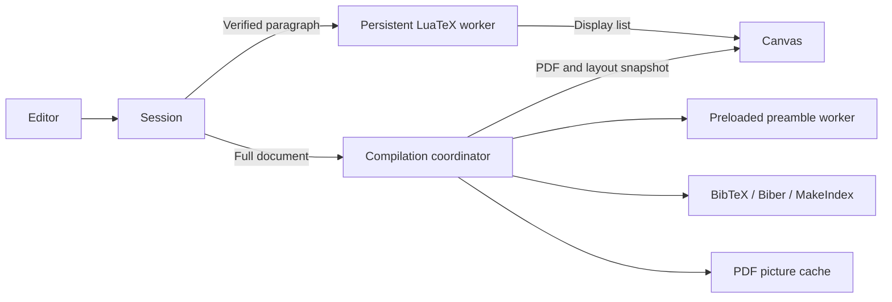

# Guide

## Editing a project

The built-in feature tour demonstrates Chinese, Japanese, Korean and English in one paragraph, font styles and colours, matrices, piecewise functions, aligned equations, integrals, series, limits, tables, lists, footnotes, cross-references, citations and a TikZ diagram. It is a single source file using bundled packages and fonts. The richer example loads its CJK fonts on startup; resource progress is shown while those files download.

Rex opens the built-in TeX example by default. Choose **Open → Recent** to reopen a saved project, or enable **Open → Recent → Open last project on startup** to resume automatically.

Choose **Open → File…** to import a portable `.rex` file or select the main `.tex` file together with `.bib`, images and local packages. **Open → Folder…** imports the entire folder, preserves nested paths and removes the selected folder's outer name. The [multi-file example](../examples/project/) includes a child document and an index; the [bibliography example](../examples/bibliography/) requires both `main.tex` and `references.bib`. With a flat file picker, match the imported filenames to the paths in your source.

The source editor uses CodeMirror 6 with LaTeX syntax highlighting, line numbers, line wrapping, bracket matching, undo / redo and two-space indentation (Tab / Shift Tab). Choose the search icon or press Ctrl/⌘ + F to find and replace. Switching files retains each file's cursor and undo history during the current visit. The file selector edits imported text files; the file marked **main** remains the compilation entry point. Uniquely captured paragraphs in `input` / `include` files can update live. Repeated inputs and dependency changes use full compilation; paragraph splits and merges can update provisionally. A child-file change also invalidates the preloaded full-pass worker so that it cannot reuse stale input.

Saved projects and portable archives retain incomplete drafts, even when the root source cannot compile. A flat import needs an identifiable complete main document; a `.rex` archive carries its root filename explicitly.

Verified paragraphs update while you type. After 650 ms of inactivity, full compilation updates page breaks, references and the PDF. Paragraph splits, merges, insertions and changes in line count paint provisional lines immediately using the captured context and page positions. Neighbouring text and page breaks settle after the full pass. Preamble edits and unsafe state changes use full compilation. Verified tables and floating table contents can update live. PNG, JPEG and PDF image references support live sizing and rotation; PDF page selection is supported. Numbered equations and alignment environments update live, using references from the last full pass. Footnote markers update live, while their bodies and placement follow the next full pass. Changed asset bytes, clipped images, unusual PDF page boxes and vector drawings use full compilation.

A failed compilation keeps the previous preview; click **Show log** in the status bar for details.

**Download → Current source file** downloads the active document; **Download → Project (.rex)** exports all source files, binary assets, nested paths and the selected file in a portable `.rex` archive. **Download → PDF** downloads the fully compiled PDF and is available when the output matches the current source. Preview updates automatically; use **Recompile** or Ctrl/⌘ + Enter to request a full pass immediately. The complete project is saved to this site's IndexedDB 500 ms after an edit and when the tab becomes hidden. **Open → Recent** retains the ten most recently saved projects, including assets, unfinished drafts and the active file. Viewing the default example does not replace a saved project; editing it creates a new saved project. Storage failures are reported in the log; clearing site data removes local projects, so keep exported backups. A legacy main source in localStorage is migrated when no saved project exists and is available through Recent.

The preview automatically highlights and scrolls to the captured paragraph containing the editor cursor. **Follow cursor** is enabled by default; toggle it in the preview bar to turn this on or off. The preference is saved in this browser. Automatic navigation waits briefly for cursor activity to pause, reuses existing source mappings without compiling, and avoids repeated scrolling within the same paragraph. Navigation uses native smooth scrolling, or jumps immediately when the system requests reduced motion. ⌘/Ctrl + Alt + J locates manually, even when the switch is off. Esc clears the highlight and restores the previous preview scroll position until you move the cursor, edit, or switch files again. Pages fit the available preview width automatically. Double-click a paragraph in the preview to select its source, switching files when necessary. Navigation uses the latest full layout at paragraph granularity; generated content or uncaptured source may have no location. Invalidated mappings wait for the next full compilation.

BibTeX and BibLaTeX with either BibTeX or Biber run locally. Changed bibliography files regenerate `.bbl`; unchanged results are reused. Full compilation runs up to five passes for convergence. TikZ, circuitikz and pgfpicture regions can reuse PDF output when source, dependencies and captured state match. Pictures using references, dynamic state or unsupported constructs are redrawn.

MakeIndex runs locally for ordinary `makeidx` documents and named `imakeidx` indexes. Literal `makeindex` options support local `.ist` styles (`-s`) and flags `-c`, `-g`, `-l`, `-r`. Results are cached by index input, options and the selected style files. Removing entries replaces the old index rather than retaining stale output. Unsupported programs or options produce a diagnostic. Macro-generated tool configuration, xindy, splitindex and glossary orchestration are outside this workflow. Indexing works offline once the existing tool resources have been loaded.

## Chinese documents

Import [examples/chinese.tex](../examples/chinese.tex), or use `\documentclass[fontset=fandol]{ctexart}`. Existing `article`, `book` or `report` documents can add `\usepackage[fontset=fandol]{ctex}` in the preamble. Rex bundles compatible CTeX, LuaTeX-ja, Chinese JFM and Fandol fonts for Chinese punctuation, line breaking, headings and mixed Chinese / English / mathematics. Chinese paragraphs support live editing and PDF export.

```tex
\documentclass[fontset=fandol]{ctexart}
\begin{document}
\section{中文标题}
你好，世界！中文与 English、数学 $E=mc^2$ 可以混合排版。
\end{document}
```

Choose `fontset=fandol` explicitly: the browser cannot use system fonts such as SimSun or PingFang. A plain `article` without a Chinese package still uses Latin fonts and will omit Chinese characters; check the compilation log for `Missing character` warnings. Fandol covers common simplified and traditional characters; uncommon characters may require an imported font with explicit file-based configuration. The starter's CJK fonts are prefetched at startup; additional resources load on demand. Loaded resources work offline. For an existing checkout, run `npm run setup:chinese` and `npm run build` to install and publish the additional resources.

The Chinese bundle also includes `enumitem` for list spacing and `fancyhdr` for headers/footers. Rex automatically fills missing CJK glyphs from the bundled Fandol Song, IPAex Mincho and Nanum Myeongjo fonts, using their character coverage. Existing glyphs keep the selected font; fallback glyphs use its size and CJK spacing. This works in full compilation, PDF export and live paragraphs without per-character macros. Characters absent from all candidates still produce a `Missing character` diagnostic; import a font covering them and select it with CTeX's font commands. Rex uses LuaLaTeX regardless of a `% !TeX program = xelatex` comment; imported XeLaTeX documents must replace engine-specific commands such as `\XeTeXglyph` and `\XeTeXcharglyph` with portable character/font commands.

The starter also demonstrates Japanese kana using Fandol and Korean Hangul with the bundled Nanum Myeongjo font. Define `\newCJKfontfamily\koreanfont{NanumMyeongjo-Regular.ttf}` after loading CTeX, then group Korean text as `{\koreanfont 안녕하세요}`. This demonstrates mixed text; language-specific document classes and comprehensive Japanese / Korean localisation are outside the starter.

## How it works



See the [project structure and module responsibilities](architecture.md) for the source map. `ui/app.js` connects the editor to `compiler/session.js` and `ui/renderer.js`; the compiler uses dedicated entries in `workers/`, shared data formats in `protocol/` and the Lua / TeX modules in `tex/`.

The live worker waits on a SharedArrayBuffer mailbox. Compile requests carry raw UTF-8 source; control messages use JSON. Registered Lua functions run the hot path without repeatedly compiling Lua strings. The worker scans font and image metadata while the host decodes geometry once. Image bytes travel once per live engine and decoded pictures are reused. Changed font bytes invalidate cached outlines, including replacements at the same path. Cached paragraph spans and a file / line lookup avoid repeated whole-document parsing and capture scans. The original unit must match captured glyphs, rules, colours, image identity and relative geometry before an edit can go live. Provisional blocks retain their original verification contexts across repeated splits and merges. Canvas reuses glyph outlines and restores and paints only the affected rectangle, including overfull glyphs. Revision, project and engine-generation checks discard stale results, including results delayed by font loading. The coordinator retains immutable engine resources when switching projects, discards obsolete work at asynchronous boundaries and resets auxiliary tools, picture caches and preloaded state. Project changes discard live patches before closing their images; the last complete PDF remains safe to redraw if compilation fails. Only the latest queued project can publish a layout. The coordinator preloads a preamble while idle; a changed preamble or dependency invalidates that standby. `compiler/full-pass.js` provides the full-compilation API; `workers/full-worker.js` installs the standby worker handler.

## Development and tests

Follow the setup commands in the [README](../README.md). Set `PORT=8082 npm run dev` to change the port. Development serves current source directly; refresh to see changes. `npm run setup:bibliography` reinstalls bibliography assets after a full setup. Asset versions and download hashes live in `scripts/setup.mjs`; FontTools is installed temporarily for Type 1 outline generation.

| Command | Coverage |
| --- | --- |
| `npm run check` | Syntax, module / worker paths, links and distribution hashes |
| `npm test` | Project round trips, incremental parsing, cache identity, WASM, frozen layout, state isolation and server boundaries |
| `npm run test:startup` | Direct file startup, offline editing, PDF export, project restore, bibliography / indexing tools and hosted live compilation |
| `npm run test:browser` | Editing, fonts, revisions, busy project switches, import / export / restore, child files, navigation, paragraph growth / splits / merges, overfull line cleanup, tables, image pixels, equations and footnote markers |
| `npm run test:webkit` | Mobile WebKit under `/rex/`: service-worker isolation, download progress, PDF export, offline reload and live editing |
| `npm run test:static` | Hosts without isolation headers, service worker and offline editing |
| `npm run test:full` | Standby, PDF picture equivalence, three bibliography backends, named indexes / styles / removal, subpath hosting and examples |
| `npm run test:chinese` | Chinese import, PDF text, Canvas font outlines, live edits, export and offline reload under a subpath |
| `npm run bench` | End-to-end edits in 10 / 100 / 300-page documents and native LuaLaTeX reference |
| `npm run bench:compare -- /path/to/checkout` | Optional native compiler comparison with an external checkout; see the performance methodology |

Run `npm run build` first. `npm run test:all` runs checks and functional suites. On Linux, `npx playwright install --with-deps chromium webkit` installs browser system dependencies. Browser suites own ephemeral servers serving `dist/` and clean up on success or failure. Regression output goes to `artifacts/tests/`; performance drivers live in `benchmarks/` and write to `artifacts/benchmarks/`.

The frozen fixture covers five cases, seven pages and 1,584 inline glyphs, including mathematics, lists, tables, rules, footnotes, links and floats. Native geometry checks run when `lualatex` is installed and otherwise report a skip. Benchmarks require it, warm up 20 edits and measure 300 per document. Shared CI runs functional checks; controlled performance runs enforce the latency gates described in the [performance report](performance.md).

## Build and deploy

```sh
npm run build
npm run preview
```

`public/` becomes the distribution root, `src/` becomes `dist/assets/`, and selected installed resources become `dist/vendor/`. The build preserves module and dependency bytes, prepares a temporary directory and replaces the previous build only after completion. A deterministic `manifest.json` lists each published file's size and SHA-256. `npm run check` compares every published file against its source.

Deploy **all of `dist/`** to a static HTTPS host. `public/` alone is incomplete. Serve `.js` / `.mjs` as JavaScript and `.wasm` as `application/wasm`; missing assets must return 404 rather than HTML. Retain all component licenses and notices.

Use these response headers:

```text
Cross-Origin-Opener-Policy: same-origin
Cross-Origin-Embedder-Policy: require-corp
Cross-Origin-Resource-Policy: same-origin
```

`_headers` supports Netlify / Cloudflare Pages; configure equivalent headers elsewhere. Relative module URLs support subpaths such as `/rex/`; redirect directory URLs to include the trailing slash.

To use Rex without a server, open the built `dist/index.html` directly in Chrome or Safari. Keep the complete `dist/` folder together. The build includes classic script bundles, Blob workers and compressed compiler resources under `dist/standalone/`, so first startup and subsequent editing work without a network connection. Local file mode uses full compilation after typing pauses; the persistent paragraph compiler requires HTTP / HTTPS because local files cannot use shared memory. Project import, source editing, navigation and PDF / project downloads remain available. Browser storage support for local files varies; the editor reports storage failures, and downloaded `.rex` projects provide portable backups.

On HTTPS hosts without isolation headers, `sw.js` adds them to cached responses and may reload the first visit. The browser must support cross-origin isolation, SharedArrayBuffer, Atomics, workers, WebAssembly and Canvas. Offline mode serves previously loaded resources; missing packages and unused bibliography tools still need an initial download. Publish resources together and reload to acquire a new version.

The [CI workflow](../.github/workflows/ci.yml) runs regression suites. The separate [Pages workflow](../.github/workflows/pages.yml) publishes the complete `dist/` directory after build checks and the static-host/offline and mobile WebKit browser tests pass. In your repository, select **Settings → Pages → Build and deployment → Source → GitHub Actions** once; pushes to `main` then deploy to the site URL shown in **Settings → Pages**. The workflow also supports manual runs on `main` from the Actions tab. Runtime assets are installed during the build, so `vendor/` and `dist/` remain ignored by Git.

On GitHub Pages, the service worker supplies isolation headers and reloads the first visit. Before relying on a published deployment, verify isolation, PDF export and an offline reload on the target host. Installation is tested on macOS and Linux; Windows can use WSL, while native Windows setup remains unverified.

The first visit downloads the typesetting runtime and fonts. The compiler preloads the starter document’s dependencies with bounded parallel requests and displays resource counts while loading. Content-hashed bundle files are reused directly from the service-worker cache; changed hashes and application code still fetch current contents. Other packages remain available on demand. After changing the pinned runtime or [starter document](../src/core/starter.js), run `node scripts/profile-startup.mjs` to regenerate the [startup profile](../src/compiler/startup-assets.js); the engine regression checks that the starter needs no synchronous resource downloads.
